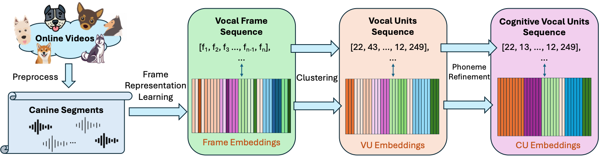
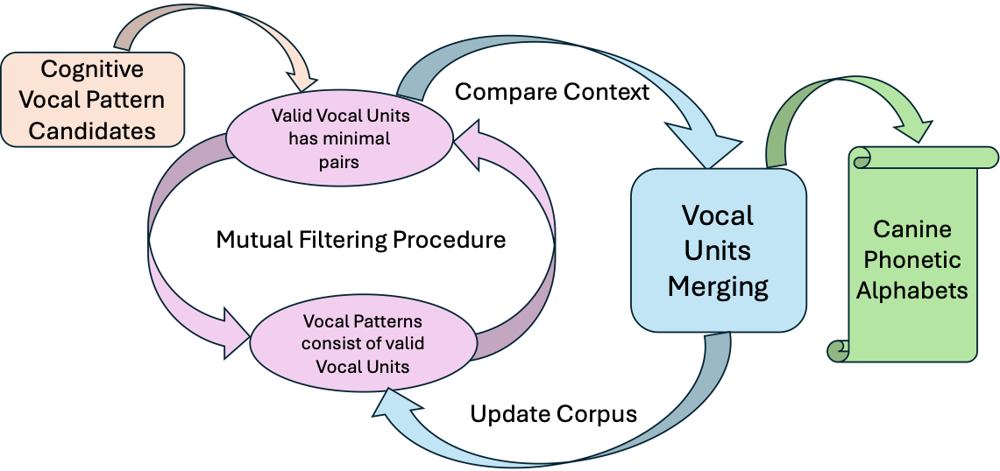
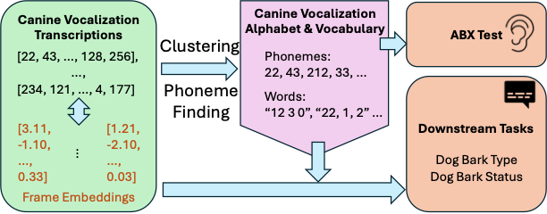
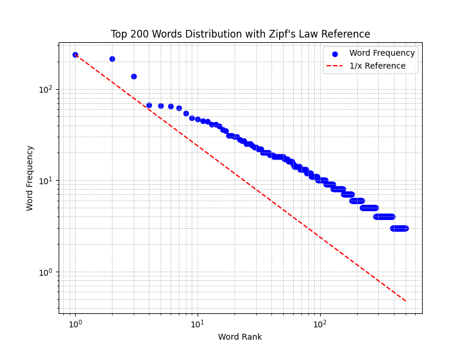

<div align="center">

# 🐕 Toward Automatic Discovery of a Canine Phonetic Alphabet

**Theron S. Wang · Xingyuan Li · Hridayesh Lekhak · Tuan M. Dang · Mengyue Wu · Kenny Q. Zhu**

University of Texas at Arlington · Shanghai Jiao Tong University

*ACL 2025 (Main Conference, Long Paper)* · 🏆 **Outstanding Paper Award**

[](https://aclanthology.org/2025.acl-long.451/)
[](https://huggingface.co/ArlingtonCL2/canine-phonetic-models)
[](https://huggingface.co/datasets/ArlingtonCL2/canine-phonetic-data)
[](LICENSE)
[](#-quick-start)



</div>

---

## 📖 Overview

Dogs communicate through vocalizations, but the phonetic properties of those vocalizations are poorly understood. This repository contains the code for an iterative algorithm, inspired by how linguists find the phonemes of an unknown language, that:

1. 🎧 **cleans and segments** dog vocalizations from thousands of hours of YouTube video,
2. 🧩 **transcribes** them into vocal units with a dog-trained HuBERT, and
3. 🔁 **refines** those units with **minimal pairs** into a canine phonetic alphabet, while discovering **vocal patterns** that co-occur with specific environments and activities.

## ✨ Highlights

<div align="center">

| 🎬 Videos | 🔊 Dog vocalizations | ✂️ Vocal segments | 🔤 Cognitive vocal units | 🗣️ Vocal patterns |
|:---:|:---:|:---:|:---:|:---:|
| **6,235 h** | **152 h** | **306,233** | **250 → 105** | **69** |

</div>

- **The largest dog vocalization dataset to date**: six breeds (Shiba Inu, Chihuahua, Husky, Pitbull, Labrador, German Shepherd).
- **Minimal-pair refinement** removes noise units and merges units that occur in the same contexts, giving a phonetic alphabet of **105** cognitive vocal units.
- **Contextual vocal patterns**: 69 patterns with strong associations to particular environments and activities. The pattern frequencies follow **Zipf's law**.

## 🚀 Quick start

```bash
git clone https://github.com/TheronWang/canine-word.git
cd canine-word
pip install huggingface_hub
python download.py            # models → ./checkpoints, data → ./data (~1.3 GB)
```

Transcribe your own dog audio into vocal units:

```python
import joblib, torch
from fairseq import checkpoint_utils

(model,), cfg, task = checkpoint_utils.load_model_ensemble_and_task(["checkpoints/dog_hubert_stage2_130k.pt"])
model.eval()
km = joblib.load("checkpoints/kmeans_layer11_k250.pkl")

wav = torch.zeros(1, 16000)  # your 16 kHz mono dog vocalization
with torch.no_grad():
    feats, _ = model.extract_features(source=wav, padding_mask=None, mask=False, output_layer=11)
units = km.predict(feats[0].numpy())  # one vocal unit (0-249) per 20 ms frame
```

Reproduce Table 2 from the released data:

```bash
python evaluation/dataset_table2.py data
```

## 📦 Models & data

| | Hugging Face | Contents |
|---|---|---|
| 🧠 | [`ArlingtonCL2/canine-phonetic-models`](https://huggingface.co/ArlingtonCL2/canine-phonetic-models) | BEATs dog sound event detector · Dog-HuBERT · K = 250 k-means · stage-1/2 HuBERT targets |
| 📊 | [`ArlingtonCL2/canine-phonetic-data`](https://huggingface.co/datasets/ArlingtonCL2/canine-phonetic-data) | Transcriptions of all 306,233 vocal segments with timestamps and candidate vocal patterns · detector segment boundaries · video durations |

> [!NOTE]
> Audio and video are not redistributed. Segment names (`<channel>+<video>+<region>+<segment>`) identify the source YouTube video.

## 🗂️ Repository structure

```
canine-word/
├── 1_preprocessing/            # §2.1  videos → clean dog vocal segments
│   ├── first_cut/              #       PANNs: find regions with dog sounds
│   ├── audiosep/               #       AudioSep with the text query "Dog"
│   ├── sed/train/              #       DCASE 2023 baseline + BEATs encoder, post-training
│   ├── sed/inference/          #       cut segments (pauses > 0.5 s)
│   └── dataset/                #       Table 2 statistics
├── 2_transcription/            # §2.2  segments → vocal units
│   ├── hubert_config/          #       HuBERT training configs
│   ├── kmeans/                 #       cluster sweep + elbow plot
│   ├── balance_data.py         #       5 s windows, 1 s overlap
│   ├── transcribe.py           #       layer-11 features → K = 250 units
│   └── trim_checkpoint.py
├── 3_refinement/               # §2.3  minimal-pair refinement (Algorithms 1-2)
│   ├── word_finder_energy.py   #       energy segmentation into candidate patterns
│   └── phoneme_finder.py       #       minimal pairs, JS divergence, merging
├── evaluation/                 # §4
│   ├── abx/                    #       ABX test (Table 4)
│   ├── downstream/             #       bark type & context classification (Tables 6-7)
│   ├── vocal_patterns/         #       Janus-Pro context, Eq. 1, Figures 5-6, Table 11
│   └── dataset_table2.py
├── results/                    # Table 11 pattern durations
├── assets/                     # figures used in this README
└── download.py
```

The scripts are the ones used for the paper. Many contain absolute paths from our servers, both in their defaults and in the example commands in their docstrings. Change these to your own paths before running.

## 🔬 Pipeline

### 1️⃣ Preprocessing: videos → vocal segments

<details>
<summary><b>First cut → AudioSep → BEATs sound event detection</b></summary>

1. **First cut.** Put `first_cut/` inside a clone of [audioset_tagging_cnn](https://github.com/qiuqiangkong/audioset_tagging_cnn) as `work/` and run `first_cut.py` on the raw video audio. It uses Cnn14_DecisionLevelMax with the Dog class, threshold 0.05 and ±1 s.
2. **AudioSep.** Put `audiosep/` inside a clone of [AudioSep](https://github.com/Audio-AGI/AudioSep) as `work/` and run `separate.py` with `--text Dog`.
3. **Sound event detection.** The detector builds on [ATST-SED](https://github.com/Audio-WestlakeU/ATST-SED):
   - Place `sed/train/*` under its `train/`, the `CRNN_beats*.py` files under `desed_task/nnet/`, and `sed/inference/*` in a work folder. The pretrained BEATs encoder is `BEATs_iter3_plus_AS2M.pt`.
   - The DCASE 2023 Task 4 baseline gets a 4-layer RNN classifier and a 256-dim CNN encoder output.
   - It is post-trained on more than 9,000 s of manually labelled pure dog vocalizations: lr 0.001, 200 epochs, batch size 4, two NVIDIA RTX 4090 GPUs (about 6 h). All of this is in `frozen_udesed.yaml`.
   - The released `beats_sed_dog.ckpt` reaches **F1 = 0.8556**.
   - `second_cut.py` runs it with threshold 0.6713 and merges detections less than 0.5 s apart into vocal segments.

</details>

### 2️⃣ Transcription: segments → vocal units

<details>
<summary><b>Three-stage Dog-HuBERT + K-means (K = 250)</b></summary>

We train HuBERT with the standard [fairseq recipe](https://github.com/facebookresearch/fairseq/tree/main/examples/hubert) and the configs in `2_transcription/hubert_config/`. Clips shorter than 0.35 s are dropped; clips longer than 5 s are cut into 5 s windows with a 1 s overlap (`balance_data.py`).

| Stage | Clusters | Released file |
|:---:|:---:|---|
| 1 | 100 (MFCC k-means) | `stage1_targets_mfcc_k100.pkl` |
| 2 | 200 | `stage2_targets_layer6_k200.pkl`, model `dog_hubert_stage2_130k.pt` |
| 3 | 250, chosen with the elbow method (`kmeans/`) | `kmeans_layer11_k250.pkl` |

- **Training:** learning rate 1e-4. Stages 1 and 2 took 20 h and 18 h on two NVIDIA RTX 4090 GPUs with a batch size of 4.
- **Vocal units:** the K = 250 clusters of layer-11 features of the stage-2 model. `transcribe.py` labels every segment.
- **Release check:** `trim_checkpoint.py` removes the optimizer state for release; the trimmed model gives identical features.

</details>

### 3️⃣ Vocal unit refinement: minimal pairs

<div align="center">

</div>

<details>
<summary><b>Energy segmentation → mutual filtering → JS-divergence merging</b></summary>

1. **Candidate vocal patterns.** `word_finder_energy.py` splits each segment at low-energy pauses with [auditok](https://github.com/amsehili/auditok). The threshold is ρ × RMS, with ρ = 3.
2. **Mutual filtering (Algorithm 1).** Keep only the vocal units that are the contrasting unit of at least one minimal pair. Keep only the patterns made entirely of those units.
3. **Merging (Algorithm 2).** Compare the contexts of each minimal pair with the Jensen–Shannon divergence. Merge unit pairs below the 5th percentile, update the transcriptions, and repeat until nothing changes. Patterns seen fewer than K = 5 times are discarded.

```python
from phoneme_finder import PhonemeFinder

finder = PhonemeFinder(parse_mode="energy",
                       parsed_transcription_file_path="metadata_trans.json",  # from word_finder_energy.py
                       valid_word_cnt_threshold=5,   # K
                       percentile=5)                 # JS-divergence merging threshold
finder.find_phonemes(context_mode="phoneme", num_context_phoneme=3, phoneme_merge_threshold=0.0)
```

We tried K ∈ {1, 3, 5} and the 5th/10th/15th percentiles, and selected K = 5 and the 5th percentile. Each run writes `config.json` (the cognitive vocal units and vocal patterns) and `mapping_phoneme.json` (the merged units).

</details>

## 📊 Results & evaluation

<div align="center">

</div>

| Result | Code | Notes |
|---|---|---|
| **Table 2**: dataset | [`evaluation/dataset_table2.py`](evaluation/dataset_table2.py) | 6,235 h of video, 152 h of vocalizations, 306,233 segments |
| **SED F1 0.8556** | [`1_preprocessing/sed/inference/test.py`](1_preprocessing/sed/inference/test.py) | on `beats_sed_dog.ckpt` |
| **Table 4**: ABX test | [`evaluation/abx/phone_eval.py`](evaluation/abx/phone_eval.py) | answer keys of the 500 initial-unit and 210 final-unit triplets in `evaluation/abx/samples/` |
| **Table 6**: bark type | [`dt_aduio_classification.py`](evaluation/downstream/dt_aduio_classification.py) | LR / RF / XGBoost on MFCC, frame, vocal-unit and cognitive-unit embeddings |
| **Table 7**: bark context | [`dt_activity_classification.py`](evaluation/downstream/dt_activity_classification.py) | surroundings / ear / tail; output in `evaluation/downstream/results/context/`; 1,008 clips labelled by five annotators |
| **Figure 5**, Eq. 1 | [`evaluation/vocal_patterns/word_meaning.py`](evaluation/vocal_patterns/word_meaning.py) | Janus-Pro-7B descriptions → 10 environment + 10 activity categories → relative frequency |
| **Figure 6**: Zipf | `word_meaning.py::plot_word_distribution2` | top 200 vocal patterns |
| **Table 11**: 69 patterns | [`results/vocal_patterns_69_durations.json`](results/vocal_patterns_69_durations.json) | durations and summaries of every pattern |

<details>
<summary><b>📈 Figure 6: the 200 most frequent vocal patterns follow Zipf's law</b></summary>
<div align="center">

</div>
</details>

## 🔗 Related work

- 🐶 **Phonetic and Lexical Discovery of Canine Vocalization** (Findings of EMNLP 2024): the first version of this pipeline, with adaptor-grammar word discovery. Code: [UTA-ACL2/canineLexical](https://github.com/UTA-ACL2/canineLexical)

## 📝 Citation

If you find this work useful, please cite:

```bibtex
@inproceedings{wang-etal-2025-toward,
    title = "Toward Automatic Discovery of a Canine Phonetic Alphabet",
    author = "Wang, Theron S.  and Li, Xingyuan  and Lekhak, Hridayesh  and Dang, Tuan M.  and Wu, Mengyue  and Zhu, Kenny Q.",
    booktitle = "Proceedings of the 63rd Annual Meeting of the Association for Computational Linguistics (Volume 1: Long Papers)",
    month = jul,
    year = "2025",
    address = "Vienna, Austria",
    publisher = "Association for Computational Linguistics",
    url = "https://aclanthology.org/2025.acl-long.451/",
    doi = "10.18653/v1/2025.acl-long.451",
    pages = "9207--9219",
}
```

## 🙏 Acknowledgements

This work is partially supported by NSF Award No. 2349713. The code builds on [PANNs](https://github.com/qiuqiangkong/audioset_tagging_cnn), [AudioSep](https://github.com/Audio-AGI/AudioSep), [ATST-SED](https://github.com/Audio-WestlakeU/ATST-SED) / DCASE 2023 Task 4, [BEATs](https://github.com/microsoft/unilm/tree/master/beats), [fairseq HuBERT](https://github.com/facebookresearch/fairseq/tree/main/examples/hubert), [auditok](https://github.com/amsehili/auditok) and [Janus-Pro](https://github.com/deepseek-ai/Janus).

## 📄 License

[MIT](LICENSE)
